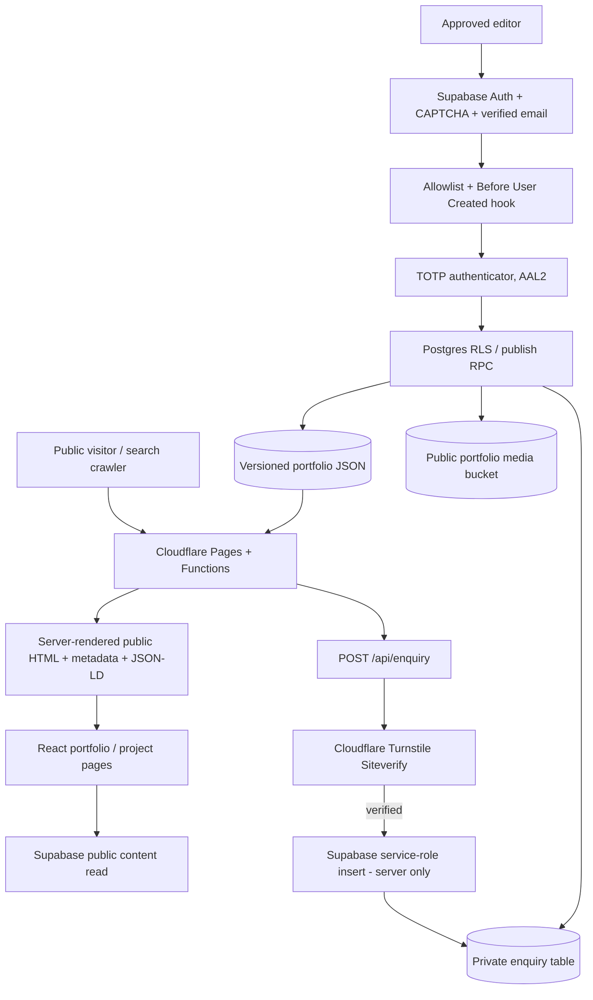

# Production architecture, logical and physical components

## Logical architecture



## Physical deployment

```text
User device / crawler
  |
  | HTTPS / DNS
  v
Cloudflare global edge
  - Pages static assets (React/Vite bundle, CSS, PDF, favicon)
  - Pages Functions (SSR, sitemap, robots, llms.txt, enquiry API, noindex)
  - Turnstile challenge + Siteverify
  |
  +-- HTTPS --> Supabase project (managed cloud)
                  - Postgres + RLS
                  - Auth email/password, verification, TOTP MFA
                  - Private enquiries
                  - Content JSON + revisions
                  - Public media storage
                  - Auth audit logs

Developer / owner
  - GitHub repository, protected branches, dependency scanning
  - Cloudflare Pages deployment and environment secrets
  - Supabase SQL migrations, auth settings, backup exports
  - Google Search Console + analytics (optional)
```

No VPS, Node API server or paid hosting plan is required for a low-traffic starter, but both Cloudflare and Supabase impose plan quotas. A domain and reliable transactional SMTP may incur costs.

## Security boundaries

| Asset | Anonymous visitor | Authenticated but unapproved | Approved with password only (AAL1) | Approved + TOTP (AAL2) |
|---|---|---|---|---|
| Public portfolio content | Read | Read | Read | Read |
| Studio UI | Login/signup screen | Access denied | MFA gate | Full editor |
| Publish portfolio | Denied | Denied | Denied | Allowed via version-checked RPC |
| Upload/delete portfolio media | Denied | Denied | Denied | Allowed |
| Read private enquiries | Denied | Denied | Denied | Allowed |
| Submit enquiry | Turnstile-verified API | Turnstile-verified API | Turnstile-verified API | Turnstile-verified API |
| View content revisions | Denied | Denied | Denied | Allowed |

**Threat controls:** SQL RLS, server-only secrets, auth allowlist hook, email confirmation, CAPTCHA, mandatory TOTP, CSP/security headers, escaped server HTML and JSON-LD, no-index admin route, upload MIME/size limits, Turnstile token verification, per-email rate limiting, optimistic version checks, 50-version rollback, and no unverified testimonials/results in structured data.

**Known limitations / operational obligations:** No system is unhackable. `/studio` login URL and JavaScript bundle are public, but private data operations are blocked by server/database authorization. Rate limiting by email is not a substitute for Cloudflare WAF/IP rules; enable them for abusive traffic. Supabase Storage is a **public bucket** for intentionally published media; do not upload private contracts, unreleased campaign files, identity documents or passwords. Verify media rights and privacy practices. Database backups and incident response must be managed outside the app. The included privacy notice is a starter, not legal advice. A security review and real end-to-end testing remain necessary.

## SEO / AEO / GEO implementation

- Public homepage `/` and approved `/work/:id` project pages are rendered by Pages Functions with **HTML content present before JavaScript**. The original React design takes over after loading.
- Per-page title, description, canonical, Open Graph, Twitter card, Person/WebSite/WebPage/CreativeWork JSON-LD; VideoObject only when real cover, video and date are provided.
- Only genuine non-placeholder projects get case-study pages and sitemap entries; unknown paths return 404.
- Dynamic `/sitemap.xml`, `/robots.txt`, optional `/llms.txt`; preview hostnames and unpublished content are `noindex`.
- Studio `/studio` is excluded from indexing with `X-Robots-Tag` and `Cache-Control: no-store`.
- Public FAQ questions and answers are editable. No FAQ rich-result promises or invented ratings.
- Dynamic content changes reach the server-rendered pages within the edge cache lifetime (120 seconds; sitemap 300 seconds), with no build required.
- Pages Functions use public Supabase API access to fetch published content, and respond with 503 if the database is temporarily unavailable, rather than indexing fake fallback content.
- Google Search Console verification and real domain are external setup steps, not something that source code alone can complete.

## Cost and performance

- Cloudflare Pages static hosting is generally free within quotas; Pages Functions count against Workers/Pages Functions usage limits.
- Supabase free plan is suitable for prototyping/light use, but storage, bandwidth, database and inactive-project limits apply; free projects may pause.
- Cloudflare Turnstile has a free offering, subject to service limits and terms.
- A custom domain, custom SMTP, large video delivery or high traffic may require paid services.
- Prefer YouTube video links and compressed WebP/JPEG images. Large hosted video uploads quickly consume free storage/egress.

## Sources / official references

- Google Search Central: https://developers.google.com/search/docs/appearance/ai-features
- Google AI optimization: https://developers.google.com/search/docs/fundamentals/ai-optimization-guide
- Google structured data: https://developers.google.com/search/docs/appearance/structured-data/intro-structured-data
- Cloudflare Pages Functions: https://developers.cloudflare.com/pages/functions/
- Cloudflare Turnstile validation: https://developers.cloudflare.com/turnstile/get-started/server-side-validation/
- Supabase RLS: https://supabase.com/docs/guides/database/postgres/row-level-security
- Supabase MFA: https://supabase.com/docs/guides/auth/auth-mfa/totp
- Supabase Auth Hooks: https://supabase.com/docs/guides/auth/auth-hooks/before-user-created-hook
